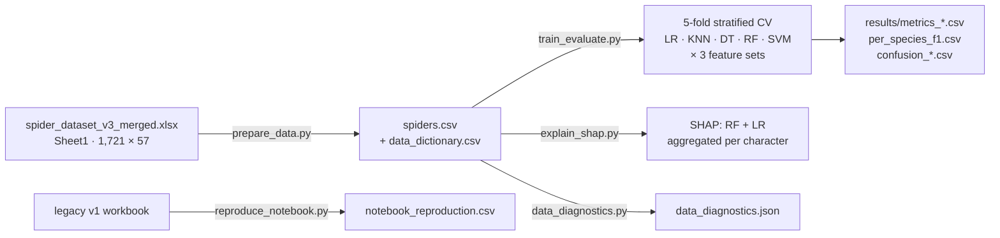
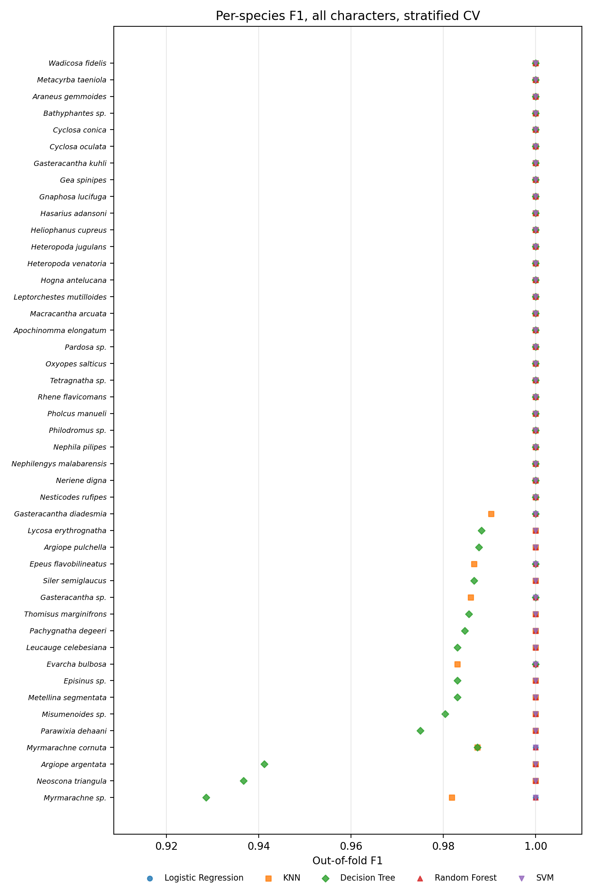
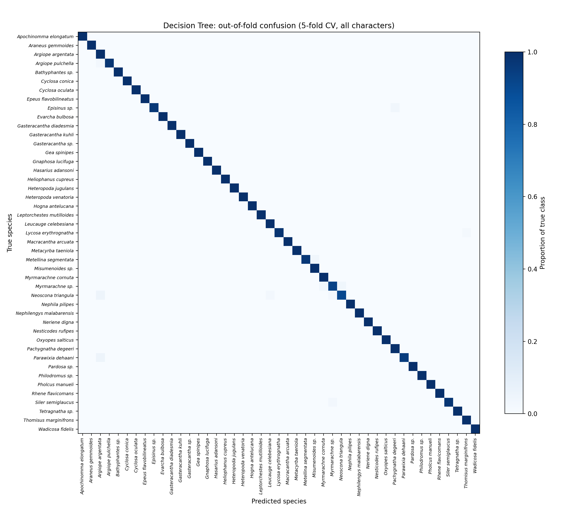
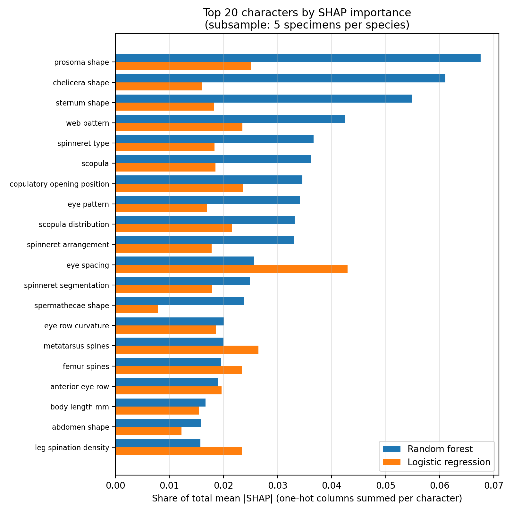

<!-- BANNER PLACEHOLDER: replace with figures/banner.png (e.g. 1280x320, spider habitus + character icons) -->
<!--  -->

# Spider species classification from morphological characters

[](https://github.com/Angsumi/MD_Machine_Learning/actions/workflows/tests.yml)


## Question

Can standard machine-learning classifiers assign spider specimens to one of 45 species
(Araneidae, Lycosidae, Salticidae, Thomisidae and others) from a matrix of
morphological characters: size measurements, carapace and abdomen shape and colour, eyes,
chelicerae, legs, spinnerets and female genitalia? Which characters carry the signal?

**Short answer, with a caveat that matters.** On this character matrix, logistic
regression, random forest and an RBF SVM reach a macro-F1 of 1.000 in 5-fold stratified
cross-validation. That ceiling mainly reflects how the matrix was built: specimen
rows are derived from species-level descriptions (see [Data provenance](#data-provenance-read-this-first)).
These numbers show that the encoded descriptions are separable. They do **not** estimate
how accurately new, real specimens would be identified.

## Data

*Morphological data collected by MD* <!-- TODO: full name and affiliation of MD -->.
Released under [CC BY 4.0](data/LICENSE) with MD's agreement. Please credit MD when reusing the data.

| File | What it is |
|---|---|
| `data/raw/spider_dataset_v3_merged.xlsx` | **Canonical workbook.** `Sheet1` has 1,721 specimen rows × 57 columns. Other sheets hold the identification-key material: `Website_Questions`, `Species_Profiles`, `Split_Characters`, per-character key sheets and `Measurement_Sources` |
| `data/processed/spiders.csv` | Tidy table built from `Sheet1` by `src/prepare_data.py`: snake_case columns, whitespace cleaned, `specimen_id` kept for joins |
| `data/data_dictionary.csv` | One row per column: original header, abbreviation, unit, type, role, levels, missing values, and the share of species in which the column is constant |
| `data/raw/legacy/` | The workbook the original notebook used (v1, 1,721 rows × 38 columns), the 45-row species-description table it was derived from (v0), and earlier drafts. See [data/README.md](data/README.md) |

The processed table has 1,721 specimens of 45 species (25 to 66 per species).
Predictors are 25 numeric and 30 categorical characters. `specimen_id` is **excluded from the
predictors**: IDs run in species order (`S0001…`), so including them would leak the label.

### Data provenance: read this first

The diagnostics below are computed by `src/data_diagnostics.py` and written to
`results/data_diagnostics.json`.

- **The legacy v1 table is an expansion of 45 species descriptions.** The v0 workbook has one
  row per species with the same 38 columns. In v1, 12 of 30 text characters copy the v0
  species text in every one of the 1,721 rows. Most others are paraphrases of it,
  e.g. "Broadly oval" → "Broadly ovate", "Broad oval", "Wide oval". The size columns are
  narrow sub-ranges ("10.3–10.4") inside the species' literature range.
- **The canonical v3 workbook has the same structure.** 14 of 55 predictors take one single
  value in every species. Those 14 alone separate 24 of the 45 species. Size varies little
  within species: the median within-species coefficient of variation for body length is
  0.041, against 0.73 between species means.
- **The workbook labels some values as simulated or estimated.** `Prosoma_Shape_Key` has a
  column "L/W range (simulated)". All 45 `Sternum_Key` rows give their basis as "Expert
  estimate (genus/family-typical), unverified". `Measurement_Sources` lists a mean and SD per
  species.

So treat this repository as a **benchmark on a description-derived character matrix**.
The open question is whether the per-specimen rows record individually examined specimens,
or are generated from species descriptions. Results should be described accordingly
until that is confirmed. <!-- TODO: confirm with MD how the per-specimen rows were produced -->

## Workflow



**Preprocessing.** Numeric characters: median imputation, then standardisation. Categorical
characters: most-frequent imputation, then one-hot encoding. Both are fitted inside each
training fold. **Models** keep the original notebook's hyperparameters: logistic
regression (`max_iter=3000`), KNN (k = 5), random forest (300 trees), RBF SVM, and a decision
tree tuned by grid search over depth × leaf size. The grid search runs inside each outer
training fold, so there is no tuning on test folds. **Evaluation**:
`StratifiedKFold(n_splits=5, shuffle=True, random_state=42)` with out-of-fold predictions.
Metrics are accuracy, balanced accuracy, macro-F1, per-species F1 and confusion matrices.

## Results

All numbers come from `results/metrics_summary.csv`: mean ± SD over the 5 folds of the canonical v3 table.

**All characters (55 predictors)**

| Model | Accuracy | Balanced accuracy | Macro-F1 |
|---|---|---|---|
| Logistic regression | 1.0000 ± 0.0000 | 1.0000 ± 0.0000 | 1.0000 ± 0.0000 |
| Random forest | 1.0000 ± 0.0000 | 1.0000 ± 0.0000 | 1.0000 ± 0.0000 |
| SVM (RBF) | 1.0000 ± 0.0000 | 1.0000 ± 0.0000 | 1.0000 ± 0.0000 |
| KNN (k = 5) | 0.9983 ± 0.0026 | 0.9979 ± 0.0033 | 0.9981 ± 0.0030 |
| Decision tree (tuned) | 0.9924 ± 0.0076 | 0.9920 ± 0.0081 | 0.9918 ± 0.0084 |

**Feature-set ablation (macro-F1)**

| Model | All | Categorical only (30) | Numeric only (25) |
|---|---|---|---|
| Logistic regression | 1.0000 | 1.0000 | 0.9627 |
| Random forest | 1.0000 | 1.0000 | 0.9934 |
| SVM (RBF) | 1.0000 | 0.9993 | 0.9531 |
| KNN (k = 5) | 0.9981 | 0.9921 | 0.9452 |
| Decision tree (tuned) | 0.9918 | 0.9913 | 0.9774 |

Out-of-fold per-species F1 is 1.0 for every species with logistic regression, random forest
and SVM. The lowest per-species F1 is 0.9286 (*Myrmarachne* sp., decision tree). See
`results/per_species_f1.csv`.

<p align="center">
  
  
</p>

**Which characters matter (SHAP).** Mean |SHAP| was computed on a stratified subsample of
5 specimens per species, summed over each character's one-hot columns, and averaged over
the 45 classes. For the random forest, the top characters are prosoma shape, chelicera shape,
sternum shape, web pattern and spinneret type, several of them constant within species.
Logistic regression spreads weight more evenly. Its top character is eye spacing.
Full table: `results/shap_importance.csv`.

<p align="center"></p>

### Reproducing the original notebook

`src/reproduce_notebook.py` re-runs the notebook's protocol on the legacy v1 workbook:
range midpoints, a stratified 80/20 split with seed 42, and 5-fold out-of-fold
predictions on the training part. All 15 numbers match the notebook's saved outputs exactly.

| Model | Hold-out accuracy | Notebook | OOF macro-F1 (train) | Notebook |
|---|---|---|---|---|
| Logistic regression | 0.9884 | 0.9884 | 0.9630 | 0.9630 |
| Random forest | 0.9884 | 0.9884 | 0.9835 | 0.9835 |
| Decision tree (tuned) | 0.9826 | 0.9826 | 0.9884 | 0.9884 |
| SVM (RBF) | 0.9536 | 0.9536 | 0.9281 | 0.9281 |
| KNN (k = 5) | 0.8145 | 0.8145 | 0.8207 | 0.8207 |

Differences between the notebook and this repository:

1. **Data version.** The notebook used legacy v1, with 38 columns, free-text paraphrases
   (up to 672 levels per character) and size given as range strings. The headline results here
   use the canonical v3 workbook: 57 columns, numeric measurements, plus leg, sternum and
   ratio characters. Four species names differ in spelling or whitespace between the two
   versions, e.g. " Hasarius adonsoni" vs "Hasarius adansoni".
2. **Protocol.** The notebook reports a single 80/20 hold-out (345 test specimens). Here,
   5-fold CV covers all 1,721 specimens, and decision-tree tuning is nested inside each
   training fold.
3. **Leakage check on v1.** A random forest given only the three range-midpoint size columns
   reaches 0.8435 hold-out accuracy. Sub-ranges sit inside each species' literature range,
   so size alone already encodes much of the species label.

Figures from the original notebook (Colab) are kept in `figures/original_notebook/`. They come
from legacy v1 and the hold-out protocol, so they are not directly comparable with the tables above.

## Reproduce

```bash
git clone https://github.com/Angsumi/MD_Machine_Learning.git
cd MD_Machine_Learning
micromamba create -f environment.yml      # or: conda env create -f environment.yml
micromamba activate spider-morphology-ml
make all     # prepare_data → train_evaluate → reproduce_notebook → explain_shap → data_diagnostics
make test    # unit tests + a small end-to-end smoke test
```

The full run takes about a minute on a laptop CPU. Seeds are fixed at 42. Results in
`results/` were produced with Python 3.11, scikit-learn 1.5.2, pandas 2.2.3, numpy 1.26.4 and
shap 0.46.0 on Linux x86_64. CI rebuilds `spiders.csv`, checks it is byte-identical to the
committed copy, runs the tests and runs the evaluation on a 6-per-species sample.

## Repository layout

```
data/        raw/ (canonical workbook + legacy/), processed/spiders.csv, data_dictionary.csv, LICENSE (CC BY 4.0)
src/         prepare_data.py, models.py, train_evaluate.py, explain_shap.py,
             reproduce_notebook.py, data_diagnostics.py
notebooks/   original Colab notebook (unchanged)
results/     metrics CSV/JSON, confusion matrices, SHAP table, diagnostics
figures/     figures produced by src/, original_notebook/ figures
tests/       pytest unit tests and smoke test
```

## Limitations

- **Description-derived data** (see above). Perfect cross-validated scores are expected when
  each species' rows vary only around one template. They say nothing about intraspecific
  variation, observer error or damaged specimens in real collections.
- **Rows are not independent.** Rows of the same species share most character states, so
  random k-fold splits put near-copies in train and test. An honest test of generalisation
  needs independently collected specimens, e.g. other localities or other observers.
- **Mostly female characters.** Epigyne and spermatheca characters assume adult females.
  Males and juveniles cannot be scored for them.
- **Closed set.** Classifiers can only return one of the 45 trained species. They have
  no "unknown species" option.
- **High-cardinality text.** Some categorical columns are compound free-text descriptions
  (up to 995 distinct strings). One-hot encoding treats near-identical strings as unrelated
  levels. The `Split_Characters` sheet and the identification-key sheets break these into
  atomic states, which would be a better encoding for future work.
- **SHAP subsample.** SHAP was computed on 225 specimens and only for RF and LR. KNN and SVM
  need KernelExplainer, which was not rerun here.

## Citation

See [`CITATION.cff`](CITATION.cff). Please cite the data as collected by MD and the code as below.

## License

Code: [MIT](LICENSE). Data in `data/`: [CC BY 4.0](data/LICENSE), credit MD.
